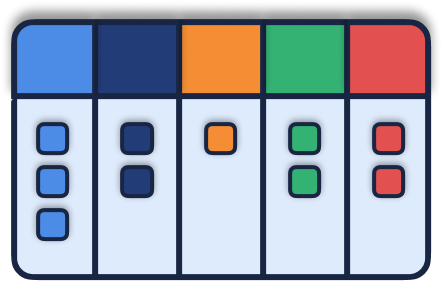

# ONboard - AI-Powered Job Tracking & Career Assistant


ONboard is a comprehensive, AI-driven platform designed to streamline your job search and boost your career strategy. It combines an intuitive Kanban tracker with powerful AI tools to help you manage applications, optimize your CV, and prepare for interviews.

> **Status:** closed beta. New sign-ups are paused; existing accounts can still log in. Visitors can try the app without an account via **demo mode**. For beta access, email info@cahitgercekel.com.



## 🚀 Key Features

### 📋 Job Tracker (Kanban Board)
*   **Drag-and-Drop Management:** Visualize your job hunt funnel through stages: Saved, Applied, Interviewing, Offer, and Rejected.
*   **AI Auto-Add:** Automatically extract job details from descriptions or links using AI.
*   **Smart Filtering & Sorting:** Filter by industry, work model, or application type. Sort by "Match Score" or date.
*   **Auto-Ghosting Detection:** Get notified when a job has been inactive for too long to keep your board clean.

### 🤖 AI Career Assistant
*   **Career Chat:** Ask open questions about your job search in a chat interface.
*   **CV Analyzer:** Detailed ATS parsing simulations and optimization feedback.
*   **Corporate Tone Adjuster:** Refine your professional communication to match industry standards.
*   **Skill Translator:** Translate technical experience into industry-specific terminology.
*   **Interview Prep:** AI-generated questions and tips based on specific job descriptions.
*   **Grammar & Polish:** Ensure your professional documents are error-free and impactful.

### 📊 Advanced Analytics
*   **Funnel Visualization:** Identify drop-off points in your application process.
*   **Role Distribution:** Analyze the types of roles you're successfully targeting.
*   **Skill Heatmaps:** See which of your skills are most in-demand for the roles you want.

### 🧪 Demo Mode
*   Try the full UI with sample data and no account. Demo data lives only in the browser tab (`sessionStorage`) and never reaches the backend. AI features are disabled in the demo.

### 🔒 Privacy & Data
*   **Data export** and **self-service account deletion** from Settings.
*   **Retention cleanup:** a scheduled edge function can remove long-inactive accounts (dry run by default).
*   Contact details are redacted from text sent to the AI assistant, career chat, and fitness scoring.
*   Legal pages: Privacy Policy, Terms, and Imprint.

### 🌍 Languages
English, German, Turkish, Spanish, French, and Chinese.

### 💳 Plans
Free and Pro tiers are defined in the app (`/billing`); checkout is not live yet. See [MONETIZATION.md](MONETIZATION.md) for the pricing model.

## 🛠 Tech Stack

*   **Frontend:** React 18 + TypeScript 5 + Vite 5
*   **Styling:** Tailwind CSS v3 + shadcn/ui
*   **State & Data:** TanStack Query (React Query)
*   **Drag & Drop:** dnd-kit
*   **Backend & Auth:** Supabase via Lovable Cloud (PostgreSQL + Row Level Security, Auth, Edge Functions)
*   **AI Engine:** Google Gemini Flash via the Lovable AI Gateway (called from Edge Functions)
*   **Charts:** Recharts & Nivo
*   **Internationalization:** i18next
*   **Testing:** Vitest (unit) + Node test runner (database / RLS tests)

## 🏁 Getting Started

### Prerequisites
*   Node.js (v18+)
*   Supabase CLI (only if you work on the edge functions or migrations)

### Installation

1.  **Clone the repository:**
    ```bash
    git clone https://github.com/cahitgercekel-hub/onboard-job.git
    cd onboard-job
    ```

2.  **Install dependencies:**
    ```bash
    npm install
    ```

3.  **Environment Variables:**
    The frontend reads these values from `.env`:
    ```env
    VITE_SUPABASE_URL=your_supabase_url
    VITE_SUPABASE_PUBLISHABLE_KEY=your_supabase_publishable_key
    VITE_SUPABASE_PROJECT_ID=your_supabase_project_id
    ```
    The publishable key is public by design (data is protected by Row Level Security). Server-side secrets such as `LOVABLE_API_KEY` and `SUPABASE_SERVICE_ROLE_KEY` belong in the Supabase / Lovable Cloud secret store, never in `VITE_*` variables.

4.  **Start the development server:**
    ```bash
    npm run dev
    ```
    The app runs on http://localhost:8080.

## 📜 Scripts

| Command           | What it does                              |
| ----------------- | ----------------------------------------- |
| `npm run dev`     | Start the Vite dev server                 |
| `npm run build`   | Production build                          |
| `npm run preview` | Preview the production build              |
| `npm run lint`    | Run ESLint                                |
| `npm test`        | Run Vitest once                           |
| `npm run test:db` | Run database / RLS tests (`supabase/tests/`) |

## 📂 Project Structure

*   `src/components/`: UI components (shadcn, Kanban, analytics, settings).
*   `src/pages/`: Main views (Tracker, Analytics, Assistant, Settings, Billing, Auth) plus `assistant/` tools and `legal/` pages.
*   `src/lib/`: Core logic, stores, AI access, data export, account deletion, and `demo/` mode.
*   `src/i18n/locales/`: Translations (en, de, tr, es, fr, zh).
*   `supabase/functions/`: Edge Functions — `ingest-job`, `career-assistant`, `career-chat`, `calculate-fitness`, `discover-jobs`, `delete-account`, `retention-cleanup`, and `_shared` helpers.
*   `supabase/migrations/`: Database schema and RLS policies.
*   `supabase/tests/`: Database tests.

---

Built to help you land your next big role.
